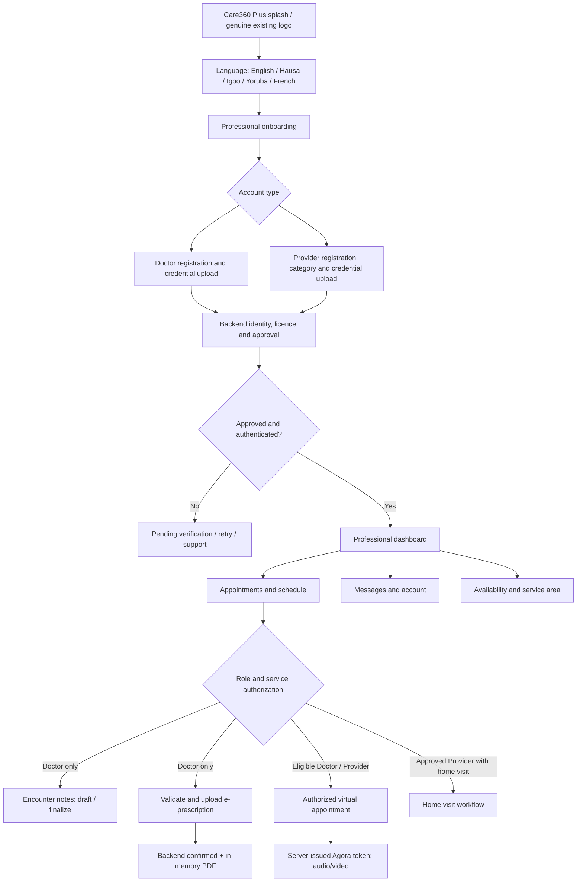

# Care360 Plus — Doctor, Provider & Telemedicine Clinical Review
**8 November 2026 · Draft source-only handover · NO APK / NO production release**

## Scope, baseline and provenance
- Repository: `Care360Apps/k3-doctor` only. No Patient or Laravel source edits.
- Stacked base: PR #32 (dashboard), PR #33 (appointment/notes visual), PR #34 (authenticated prescription upload and in-memory viewer). The present branch starts at #34 head. Earlier first-launch/language and Nearby Care drafts are inherited, not independently certified.
- All test personas/data must be synthetic. Never use real patient records, clinical passwords, or production payments.
- **Verification distinction:** source changes and automated test definitions exist; Flutter compilation, Android/iOS execution, backend API authorization, two-device Agora, and staging tests have **not yet passed**. The repository private CI has failed before Flutter (see below).

## Visual-first review: editable workflow map


## Layout preview (concept; not a compiled screenshot)
```text
┌───────────────────────────────────┐
│ CARE360 +     Doctor / Provider   │
│  [Language]       [Profile]       │
├───────────────────────────────────┤
│ Good day, Dr Ada (FICTIONAL)      │
│ Verification: backend-confirmed   │
│ Availability: server-confirmed    │
├───────────────────────────────────┤
│ Appointments   Schedule          │
│ Clinical Notes*   Messages       │
├───────────────────────────────────┤
│ TODAY'S APPOINTMENTS              │
│ Patient: Test Patient A           │
│ 10:30  •  Video  •  Pending       │
│ [Details] [Join when authorized]  │
├───────────────────────────────────┤
│ Earnings   Subscription  Settings │
└───────────────────────────────────┘
 *Doctor only. Provider substitutes Services /
  Home Visits / On-duty where supported.
```
Design reference: existing Care360 medical navy/teal, existing bundled logo and professional healthcare photography, adequate contrast, descriptive controls and 320px narrow-screen navigation. No screenshots from a real app are claimed.

## Source change inventory in this draft
1. **Prescription validation:** require Doctor role, 1–50 medicines, valid name, days 1–365, daily dose selection and parity between PDF and uploaded JSON. Deny invalid input before creating/sending medical PDFs.
2. **Upload transport:** use secure cached bearer session, reject unauthenticated attempts and redirects, bound request and response wait to 30 seconds, accept only HTTP 2xx with explicit `success: true`. A failed/uncertain upload does not display a successful preview. After confirmed upload, refresh server appointment state.
3. **Private PDF retrieval:** reject public legacy `/prescription/upload/...` links on Plus. Only HTTPS, same-origin, appointment-matching `/api/medical-files/appointments/{id}/prescription` is eligible. Require bearer token, refuse redirects, enforce 10 MB cap/PDF signature and render in app memory. **Important:** refusal does not remove the historical public file from the server. Backend migration and public access withdrawal remain P0 blockers.
4. **Clinical notes:** secondary client-side Doctor-role and valid-session gate; no edit path for finalized notes. Backend must still enforce appointment ownership, approved clinician role and immutable finalization.
5. **Agora:** deny missing clinician session, RTC token, App ID, channel, or outgoing recipient before joining. Await the join operation. Move emergency engine-release timer from call initialization to the leave sequence so an active call is not automatically released 10 seconds after joining. An accessible audio-only toggle suppresses local video while retaining the authorized audio session. Server must bind tokens to the authorized appointment.
6. **Session integrity:** await OS keystore/keychain token persistence before navigating on login. Don't report secure storage writes as successful if they fail. Await sensitive session deletion and Firebase sign-out on known logout routes.
7. **Chat password safety:** the SignIn flow no longer reuses the clinician password for Firebase registration/sign-in; the legacy AuthProvider password method is disabled. Chat requires a valid Laravel-issued Firebase custom token, otherwise it remains unavailable. This deliberately removes an unsafe fallback and requires backend token support.
8. **CI:** change Flutter pin to 3.38.4 to match the lockfile; add stacked visual and clinical safety tests to the quality job.

## Workflow/functionality matrix
| Area | Observed source | Verification required |
| --- | --- | --- |
| Doctor/Provider registration | Separate UI and routes; file credential picker; provider type API | Real server approval/verification, proof checking, negative cases |
| Login / identity | Separate endpoints, OTP flow, cached role, Firebase custom token with legacy fallback | Token persistence on Android/iOS; revoke/expire tests; ensure no password reuse for Firebase fallback |
| Dashboard / appointments | Existing role-aware dashboard and appointment history/detail routes | Owner-only queries, pending/cancel/complete states, correct time zones |
| Notes / care plans | Appointment-scoped draft/final APIs; added client role checks | Final immutability, append-only addendum policy, backend doctor+appointment authorization |
| E-prescription | PDF, multipart upload, confirmed result, protected preview | Backend licence+doctor check, medicine validation, atomic persistence, idempotent submit, private storage |
| Provider services | Provider category, offers video/home, opt-in Nearby Care shifts | Scope-of-practice checks, service price, location privacy, provider availability API |
| Calls | Agora RTC flow and clinician token fetch; added fail-closed joins | Two-device video/audio, expiration and renewal, reconnect, recipient/appointment binding |
| Chat | Firebase Firestore UI and backend custom-token path | Firestore rules, sender/recipient authorization, per-conversation membership, no legacy password fallback |
| Payments/earnings | Payment, subscription, payout/withdrawal screens/routes exist | Signed webhook/status verification and payout reconciliation by backend |
| Five languages | Switcher and JSON translation files exist | Coverage audit; fallback to English where untranslated, talkback/screen-reader review |
| Images/reports | Existing medical image URLs outside PDF client | Backend private-file migration, audit logs and access revocation (NOT fixed here) |

## Backend & security integration contract (requirements, not claims)
- `GET /api/medical-files/appointments/{appointmentId}/prescription`: authenticated clinician only if current appointment owner and role permitted; return `application/pdf`, no redirect and `Cache-Control: no-store`. HTTP 401 on expired credentials; 403 for another clinician/provider without access; 404 for unavailable documents. Do not expose public paths, signed permanent URLs or token query parameters.
- `POST /api/add_prescription`: validate approved Doctor licence and appointment ownership; reject Provider accounts; validate medicines, file content/type and limits; atomically save private file and return JSON `{ "success": true, ... }` **only after persistence**. Return 4xx/5xx with `success:false` on failure. Add idempotency keys or prevent duplicate prescriptions on retried uncertain outcomes.
- `GET/POST/PATCH /api/doctor-notes`: scope by authenticated Doctor and appointment; authorize read/write separately; no edit/delete of finalized notes; append new addendum and audit all changes.
- Agora token endpoint: require approved clinician, active booked appointment, authorized recipient, appropriate time window, short-lived token, dedicated non-guessable channel. Forbid tokens based solely on an arbitrary `to_id`.
- Provider role API: category/license scopes, video/home visit permissions, price, opt-in radius and shift expiry. Never grant prescribing privileges based on UI flags.
- Chat: backend Firebase custom tokens for the correct clinician identity; Firestore security rules for per-appointment conversation membership; revoke on logout/account disable; the removed client-password Firebase fallback now requires Laravel custom-token parity and provider-specific Firestore authorization before launch.
- Payments: validate status server-side with payment provider; client callback alone must never finalize patient access/earnings; keep payment keys off-device.
- Historical PDFs, lab reports and images: inventory -> private copy -> ownership/metadata reconciliation -> authorization checks -> revoke public serving -> audit. Preserve old records until verified; no public migration shortcut. Coordinate separately with backend owner.

## Required staging acceptance matrix — fictional data only
| ID | Persona / test | Expected |
| --- | --- | --- |
| D01 | Fictional approved doctor registers/logs in | verified approval and isolated session |
| D02 | Unapproved doctor opens clinical notes | blocked on server, no PHI returned |
| D03 | Doctor A requests Doctor B's appointment/notes/PDF | 403/404, never exposed |
| D04 | Doctor creates draft, finalizes, attempts edit/delete | saved draft; finalized note immutable |
| D05 | Missing medicine/duration/dose | no upload request, actionable validation |
| D06 | Timeout, 4xx, redirect, 2xx `success:false` | no success preview, retry guidance |
| D07 | Valid upload with committed private PDF | confirmed once, appointment state refreshed |
| D08 | Legacy public PDF | fail closed on Plus; backend must remove public access |
| P01 | Provider signs up with category and licence | approval/category reflected, separate role |
| P02 | Provider attempts e-prescription and Doctor notes | client blocked and server 403 |
| P03 | Eligible Provider enables home visits/on-duty | only server-confirmed shift displayed |
| P04 | Doctor attempts Provider-only home visit | denied |
| T01 | Agora missing/expired token, absent recipient | no RTC join, safe error |
| T02 | Two fictional clinician/patient accounts with authorized appointment | stable call beyond 10 seconds, audio-only switch and return to video, hangup releases engine |
| T03 | Third-party user attempts Agora/Firestore session | server token/rules refuse access |
| A01 | Logout and change accounts on Android/iOS | secure bearer removed, Firebase signed out, no prior notes/chat |
| C01 | 320px UI, large text, reduced bandwidth, locale switch | no overflow; language fallback accurate |
| F01 | Subscriptions, payout, failed payment/webhook | no local-only success or unjustified earnings |

## CI observations, limits and release gate
- Earlier private quality run [42448915149](https://github.com/Care360Apps/k3-doctor/actions/runs/42448915149) failed at `source-safety`; `flutter-analyze` skipped. The GitHub job-log URL returned not found. Another PR #34 run [42452689087](https://github.com/Care360Apps/k3-doctor/actions/runs/42452689087) also failed before Flutter. **Root cause is not verified** (could be runner/billing/permissions, not established from logs).
- Public independent QA reported missing `CARE360_DOCTOR_SOURCE_READ_TOKEN` for the separate private source. Provide read-only Contents scope for **only** `Care360Apps/k3-doctor`; never paste a token in chat or a PR. Do not conflate this with Patient's builder token.
- Flutter and Dart executables are unavailable in the inspection runtime. Unit/widget test files exist but **not executed** there. No Android/iOS simulator, device or staging environment was exercised.

### Developer handover / no-release checklist
- [ ] Fix private CI runner access and obtain full source-safety/analyze/test logs for exact PR head.
- [ ] Run `flutter pub get`, `dart run build_runner build --delete-conflicting-outputs`, `flutter analyze --no-fatal-warnings --no-fatal-infos` and all offline tests on Flutter 3.38.4+; record SHA, environment and results.
- [ ] Rebuild Retrofit generated code only on this repo's review branch; preserve environment-defined API URL.
- [ ] Verify Doctor and Provider ownership/approval tests with isolated backend and fictional accounts, including 401/403/404 denials.
- [ ] Confirm historical files are migrated and public access shut down before enabling protected viewer in production; confirm Android/iOS PDF upload in staging.
- [ ] Verify Agora token issuance/expiry/renewal and two-device sessions lasting over 10 seconds, voice, video, reconnect and hangup.
- [ ] Test chat rule isolation, identity-switch logout, notifications, payment/earnings and provider home-visits.
- [ ] Independently verify dark/light layouts and accessibility on narrow Android/iPhone screens. Compare real logo/onboarding with approved Patient design system.
- [ ] Obtain QA, privacy/security and clinical signoff; only then prepare one final Android review build for developer handover. iOS separately validated. **No APK/merge/publication authorized or performed by this PR.**
